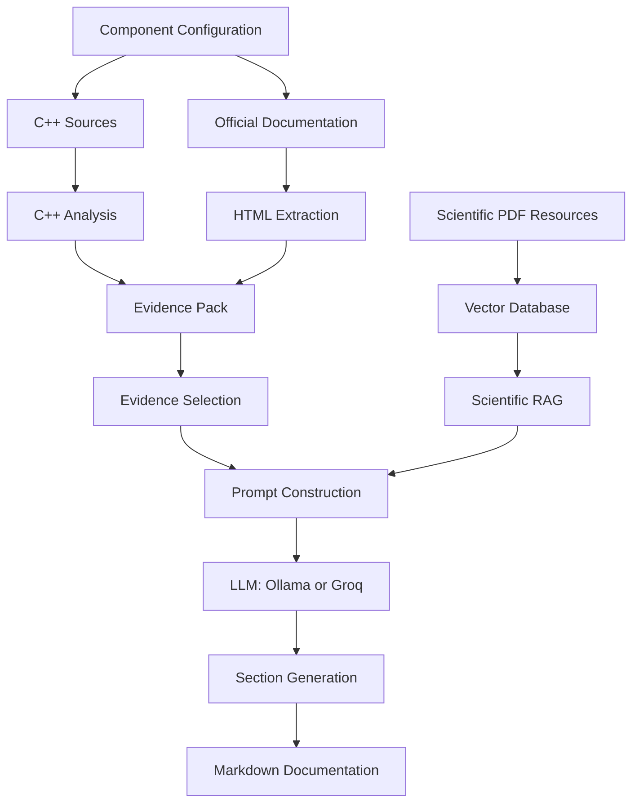

# SOFA Documentation Pipeline

## 1. Introduction

The SOFA Documentation Pipeline is a modular, evidence-grounded MVP designed to automatically generate technical and scientific documentation for SOFA C++ components using Large Language Models (LLMs).

The pipeline combines structured C++ source code analysis, official SOFA documentation, and scientific Retrieval-Augmented Generation (RAG).

Its main objective is to provide an extensible documentation-generation architecture rather than a solution restricted to a fixed set of components.

The current MVP has been experimented with six SOFA components:

- BarycentricMapping
- CGLinearSolver
- PCGLinearSolver
- NewmarkIntegrationScheme
- BDFIntegrationScheme
- NewtonRaphsonSolver

Additional components can be integrated through JSON configuration.

## 2. Project Structure

```text
sofa_doc_pipeline/
│
├── config/
│   ├── components_map.json
│   ├── settings.py
│   ├── llm_settings.py
│   └── prompts.py
│
├── core/
│   ├── ingestion/
│   ├── cpp/
│   ├── docsofa/
│   ├── evidence/
│   ├── rag/
│   ├── llm/
│   ├── generation/
│   ├── evaluation/
│   └── validation/
│
├── data/
│   ├── articles/
│   ├── raw_sofa/
│   ├── intermediate_json/
│   ├── vector_db/
│   ├── experiments/
│   └── output_docs/
│
├── tests/
├── .env
├── .gitignore
├── README.md
└── main.py
```

### Configuration

| File | Description |
|---|---|
| `components_map.json` | Component definitions, source paths and documentation references. |
| `settings.py` | General pipeline configuration. |
| `llm_settings.py` | LLM providers and generation parameters. |
| `prompts.py` | Section-specific generation instructions. |

### Core Modules

| Module | Responsibility |
|---|---|
| `ingestion/` | Source acquisition, Git version management and caching. |
| `cpp/` | C++ parsing, inheritance enrichment, method linking, attribute consolidation and AST-based extraction. |
| `docsofa/` | Official HTML documentation extraction. |
| `evidence/` | Evidence Pack construction, selection and formatting. |
| `rag/` | Scientific document processing, embeddings, indexing and retrieval. |
| `llm/` | Ollama and Groq provider integration. |
| `generation/` | Section-specific documentation generation. |
| `evaluation/` | Experimental recording and metadata management. |
| `validation/` | Reserved for future Auditor and Verifier modules. |

### Data Directories

| Directory | Content |
|---|---|
| `articles/` | Scientific and technical PDF resources. |
| `raw_sofa/` | Downloaded C++ and HTML source files. |
| `intermediate_json/` | Structured extraction results and Evidence Packs. |
| `vector_db/` | Scientific vector database. |
| `experiments/` | Experimental prompts, evidence, responses and metadata. |
| `output_docs/` | Generated Markdown documentation. |

## 3. Pipeline Methodology

The pipeline follows five main stages.

### Stage 1 — Resource Acquisition

Retrieve C++ source files and official SOFA documentation.

Git commits, source paths and file hashes are preserved to support traceability and reproducibility.

Direct parent-class sources are also retrieved when available.

### Stage 2 — Knowledge Extraction

Transform raw resources into structured information:

- C++ classes and inheritance relationships.
- Local and inherited Data fields.
- Methods and implementation bodies.
- AST-based code chunks.
- Official documentation, equations, tables and examples.

C++ extraction relies on Tree-sitter, while HTML extraction relies on BeautifulSoup.

### Stage 3 — Evidence Construction

Combine the extracted information into a unified `evidence_pack.json` for each component.

Evidence Packs preserve technical information and its original source references.

Section-specific selectors prepare relevant evidence while reducing unnecessary information and redundancy.

### Stage 4 — Scientific RAG

Scientific and technical PDF documents are processed and indexed using:

- Nomic Embed Text.
- Ollama.
- ChromaDB.
- Semantic similarity retrieval.

Scientific context is retrieved when relevant to the requested documentation section.

### Stage 5 — Documentation Generation

The LLM receives selected evidence, section-specific instructions and optional scientific context.

Each section is generated independently and can subsequently be assembled into a complete Markdown document.



## 4. Documentation Structure

Each component documentation contains six complementary sections.

| ID | Section |
|---|---|
| 1 | Component Overview |
| 2 | Architecture and Inheritance |
| 3 | Mathematical Formulation |
| 4 | Internal Architecture and Execution |
| 5 | Data Fields and Links |
| 6 | Diagnostics and Usage |

Section-based generation provides:

- Better context-window management.
- Flexible evidence selection.
- Simplified source traceability.
- Independent section regeneration.
- Specialized prompts and generation settings.
- Optional scientific enrichment.

## 5. Installation and Configuration

### Create a Virtual Environment

```powershell
python -m venv .venv
```

Activate the environment on Windows:

```powershell
.\.venv\Scripts\Activate.ps1
```

Install the dependencies using the project's dependency file, if available.

```powershell
pip install -r requirements.txt
```

### Configure Groq

Create a `.env` file at the project root:

```env
GROQ_API_KEY=your_api_key_here
```

Never commit this file to Git.

### Configure Ollama

Install and start Ollama if local generation or scientific embeddings are required.

Download the embedding model:

```bash
ollama pull nomic-embed-text
```

The local generation model can be configured in `config/llm_settings.py`.

## 6. Usage

The main entry point is `main.py`.

The generation commands assume that the required Evidence Packs and scientific indexes have already been prepared.

### Display Available Commands

```powershell
python main.py --help
```

### List Available Components

```powershell
python main.py --list-components
```

### List Documentation Sections

```powershell
python main.py --list-sections
```

### Generate a Single Section

Generate the mathematical formulation of CGLinearSolver:

```powershell
python main.py --component CGLinearSolver --sections 3
```

### Generate Multiple Sections

```powershell
python main.py --component CGLinearSolver --sections 1,2,3
```

### Generate Complete Documentation

```powershell
python main.py --component CGLinearSolver --sections fully
```

### Select an LLM Provider

Using Groq:

```powershell
python main.py --component CGLinearSolver --sections fully --provider groq
```

Using Ollama:

```powershell
python main.py --component CGLinearSolver --sections fully --provider ollama
```

### Configure the Generation Delay

To reduce temporary provider rate-limit errors:

```powershell
python main.py --component CGLinearSolver --sections fully --delay 60
```

### Adjust the Output Token Budget

```powershell
python main.py --component NewtonRaphsonSolver --sections 5 --max-output-tokens 3072
```

## 7. Generated Results

Generated documentation and execution metadata are stored in:

```text
data/output_docs/
```

Example:

```text
data/output_docs/
├── CGLinearSolver_FULL_<run_id>/
├── CGLinearSolver_S3_<run_id>/
└── NewtonRaphsonSolver_S5_<run_id>/
```

The pipeline supports both independent section generation and complete Markdown documentation assembly.

Generation statuses include:

- `SUCCESS`: all requested sections were generated.
- `PARTIAL_SUCCESS`: only part of the requested documentation was generated.
- `ERROR`: a generation operation failed.

Structural generation success does not guarantee complete factual correctness.

## 8. Extending the Pipeline

To integrate a new SOFA component:

1. Add its definition to `config/components_map.json`.
2. Specify its source files, Git reference and documentation URL.
3. Prepare the associated scientific resources if required.
4. Run the ingestion and extraction stages.
5. Build its Evidence Pack and scientific index when applicable.
6. Generate the requested documentation sections.

The pipeline is designed to support new components without changing its general architecture.

Large-scale scalability remains to be experimentally evaluated.

## 9. Current Limitations and Future Work

The current implementation is an experimental MVP.

Future development includes:

- Recursive C++ inheritance and dependency analysis.
- Deeper understanding of delegated implementations.
- Scientific corpus enrichment.
- Automated evidence auditing.
- Factual and citation verification.
- Comparison of different LLMs for each section.
- Automatic retry and generation recovery.
- Validation on additional SOFA components.
- Automatic component discovery.
- Git repository monitoring and selective documentation updates.
- Multimodal analysis of scientific figures and diagrams.

## 10. Acknowledgements

This project relies on the SOFA framework and its open-source technical and scientific resources.

- SOFA Framework: https://www.sofa-framework.org/
- SOFA Repository: https://github.com/sofa-framework/sofa
- Official Documentation: https://sofa-framework.github.io/doc/

## Author

**Amine ESSAHRAOUI**

Scientific supervision: **Zeinab AWADA**

2026
